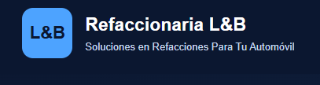

# Refaccionaria L&B

**Soluciones en Refacciones Para Tu Automóvil**

## Implementación de una plataforma web con agentes inteligentes en Microsoft Azure

**Proyecto académico — Entrega del 6 de noviembre de 2026**

**Elaborado por:**
**Mónica Torres Córdova**
**Orlando Torres Córdoba**

**Aplicación web:** https://refaccionarialb-hpbaffdrbyh2hxhx.northcentralus-01.azurewebsites.net/

> **Alcance:** plataforma académica de demostración. Los productos, precios, existencias y propuestas son datos de prueba. No se realizan ventas, pedidos ni compras reales.

---

## 1. Presentación del proyecto

Refaccionaria L&B es una propuesta de transformación digital orientada a mejorar la consulta de refacciones automotrices, la organización del inventario y la atención a los clientes. El proyecto evolucionó de procesos manuales a un catálogo estructurado en Excel y, posteriormente, a una aplicación web alojada en Microsoft Azure, conectada a Azure SQL e integrada con asistentes basados en LangGraph y Microsoft Foundry.

La aplicación contempla **dos tipos de acceso: Cliente y Administrador**. El catálogo y los asistentes apoyan la consulta; el panel administrativo permite revisar información del inventario y propuestas preliminares de reabastecimiento.

## 2. Problemática identificada (AS-IS)

En la situación inicial, la información de refacciones y las solicitudes de clientes se gestionaban manualmente, con dificultades para centralizar productos, consultar precios y existencias, localizar piezas compatibles y detectar necesidades de reposición.

**Necesidades identificadas:** organizar la información en un solo catálogo; agilizar consultas; identificar existencias bajas; apoyar la atención al cliente; y disponer de indicadores para la administración.

**Resultado de esta etapa:** definición de una solución por fases, comenzando con la digitalización del catálogo y continuando con su integración en la nube.

## 3. Objetivos

**Objetivo general:** desarrollar una plataforma web académica en Microsoft Azure que facilite la consulta de refacciones, centralice información del inventario y demuestre la integración de agentes inteligentes.

**Objetivos específicos:** digitalizar el catálogo; migrar datos a Azure SQL; construir una aplicación accesible por navegador; diferenciar los accesos de Cliente y Administrador; integrar LangGraph y Microsoft Foundry; presentar indicadores y propuestas de reabastecimiento; y documentar pruebas, seguridad y limitaciones.

## 4. Etapa 1. Digitalización del catálogo en Excel

**Objetivo.** Organizar los datos de las refacciones en un formato estructurado antes de implementar la base de datos.

**Actividades.** Se preparó un catálogo en Microsoft Excel con códigos, nombres de refacciones, categorías, marcas, datos vehiculares, números de parte, precios y existencias. Se trabajó con **500 productos de demostración**.

**Resultado.** Catálogo inicial estructurado que sirvió como base para la migración a Azure SQL.

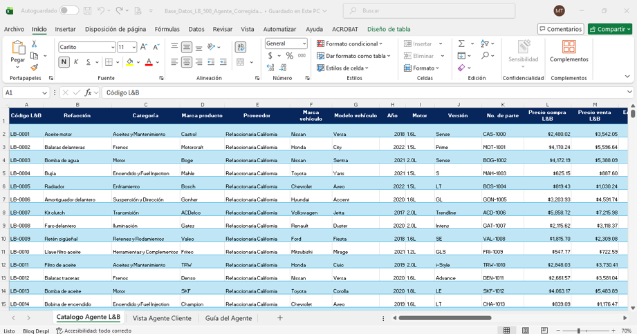

*Figura 1. Evidencia de la organización inicial del catálogo en Excel.*

## 5. Etapa 2. Migración e implementación de Azure SQL

**Objetivo.** Centralizar la información y habilitar su consulta desde la aplicación web.

**Actividades.** Se configuró la base de datos `RefaccionariaLB_DB` en el servidor `refaccionarialb-sql` y se incorporaron **500 registros** en `dbo.Productos`, tabla que contiene **26 campos**. Se verificaron consultas y estructuras para productos públicos y análisis de reabastecimiento.

Entre los campos se encuentran `CodigoLB`, `Refaccion`, `Categoria`, `MarcaProducto`, `Proveedor`, `MarcaVehiculo`, `ModeloVehiculo`, `Anio`, `NumeroParte`, `PrecioCompra`, `PrecioVenta`, `Existencia`, `ExistenciaMinima`, `CompatibilidadVerificada`, `VisibleCliente` y `EstadoInventario`.

Se identificaron también la vista `dbo.ProductosPublicos` y las tablas `dbo.PropuestasReabastecimiento` y `dbo.DecisionesReabastecimiento`. No se presupone un esquema de relaciones físicas que no haya sido comprobado.

**Resultado.** Inventario centralizado y consultable mediante una API de la aplicación.

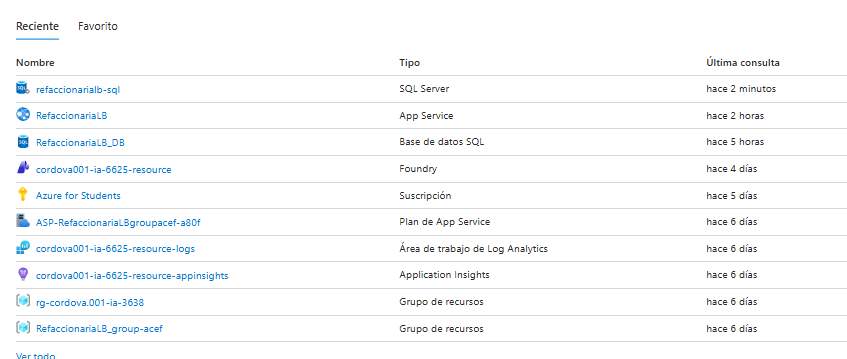

*Figura 2. Recursos de Microsoft Azure utilizados en la implementación.*

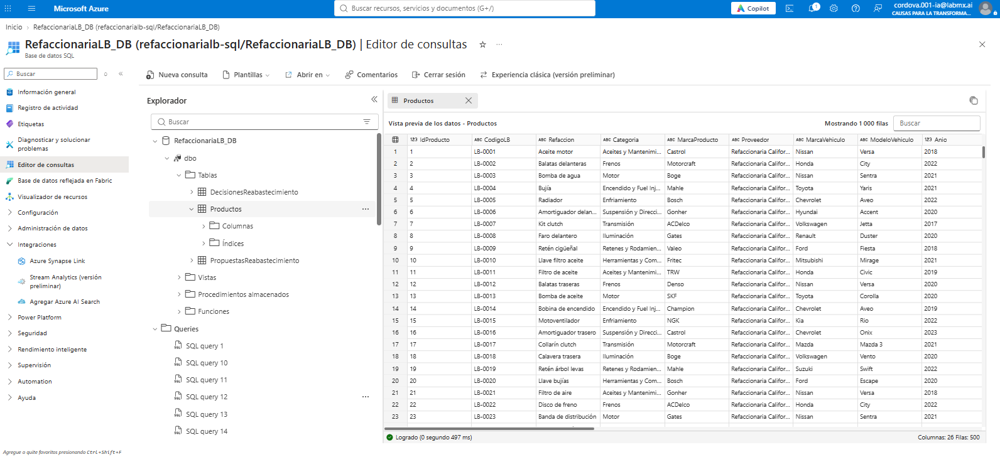

*Figura 3. Consulta de registros de productos en Azure SQL.*

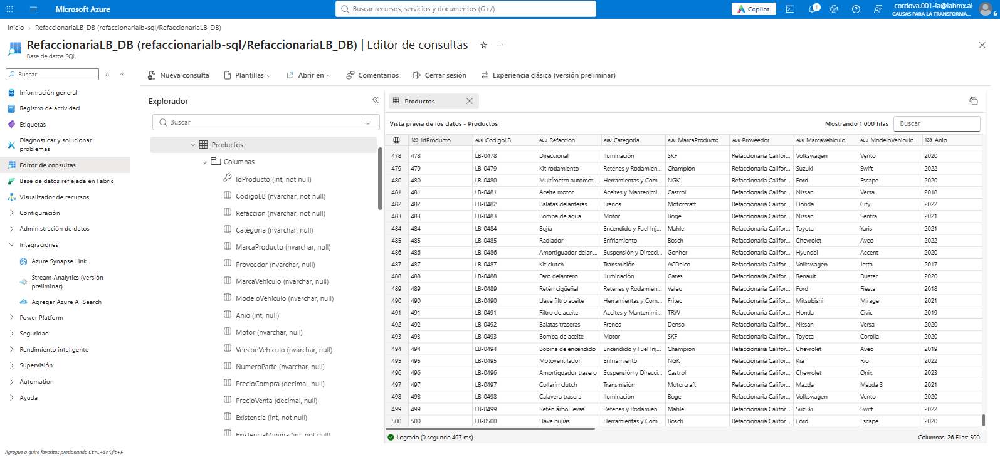

*Figura 4. Estructura de campos de identificación, clasificación y compatibilidad.*

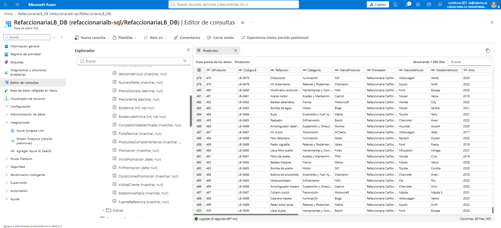

*Figura 5. Estructura de campos de inventario, promociones y visibilidad.*

## 6. Etapa 3. Desarrollo de la aplicación web y sus funcionalidades

**Objetivo.** Ofrecer una interfaz accesible desde un navegador, conectada con el inventario digital.

**Actividades.** Se desarrolló una aplicación con **Node.js, HTML, CSS y JavaScript**, alojada en **Azure App Service**. El despliegue está integrado con **GitHub Actions**. La navegación contempla Inicio, Servicios, Catálogo, Nuestro proyecto y Administrador.

**Resultado.** Sitio web accesible mediante la dirección indicada al inicio del documento. La versión local incorpora los nombres de los autores en la bienvenida y los créditos; **esos cambios todavía requieren el despliegue final** para verse en Azure.

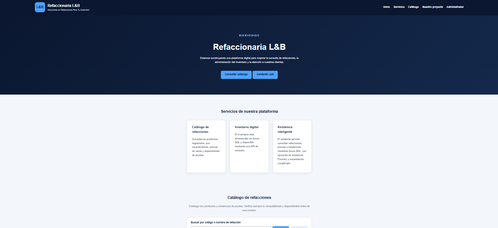

*Figura 6. Página principal de la aplicación web antes de publicar los ajustes finales de autoría.*

### 6.1. Catálogo para clientes

El catálogo permite buscar refacciones por código o nombre y consultar información de los productos, incluyendo marca, vehículo, número de parte, precio y existencia de demostración. La compatibilidad y disponibilidad deben confirmarse antes de cualquier operación real.

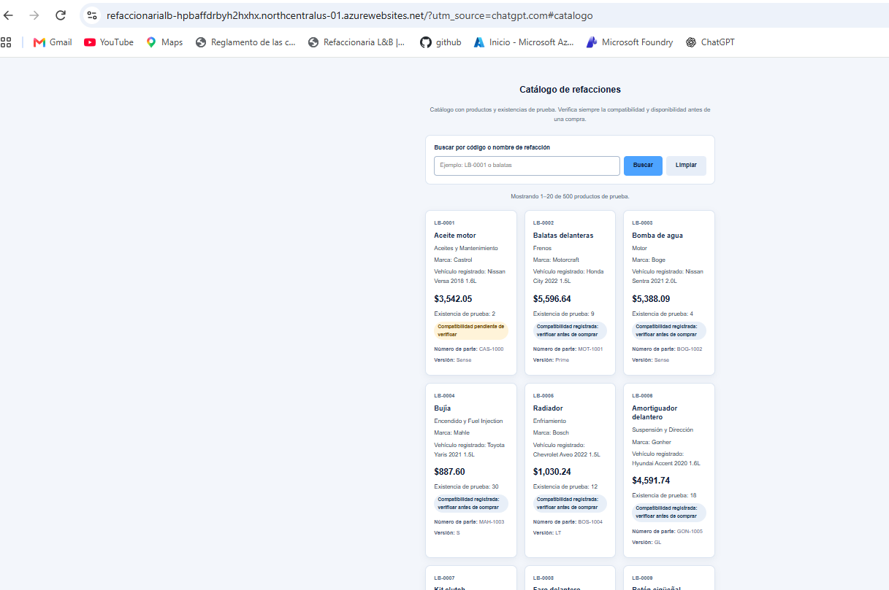

*Figura 7. Catálogo de refacciones consultable desde el navegador.*

### 6.2. Asistente de refacciones

El sitio incluye un asistente L&B para realizar consultas y seleccionar entre **Orquestación LangGraph** y **Asistente Foundry**.

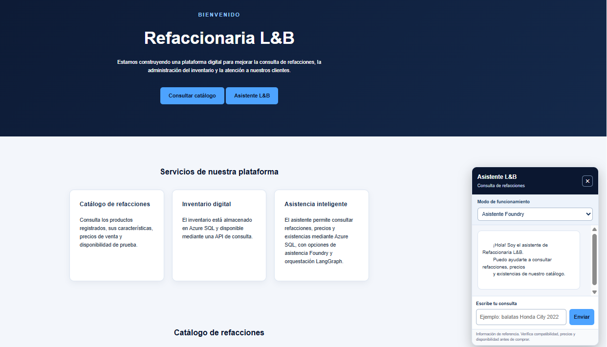

*Figura 8. Interfaz del asistente de consultas.*

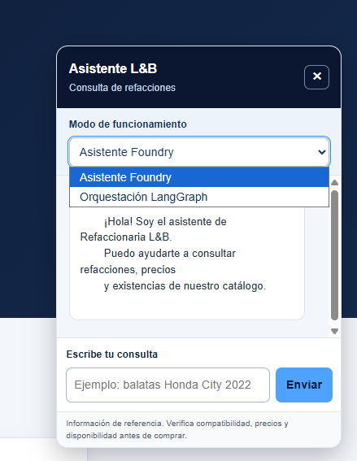

*Figura 9. Selección de los modos LangGraph y Foundry.*

### 6.3. Acceso y panel administrativo

El acceso administrativo está protegido por autenticación. El panel permite consultar indicadores y revisar el estado del inventario y las propuestas preliminares.

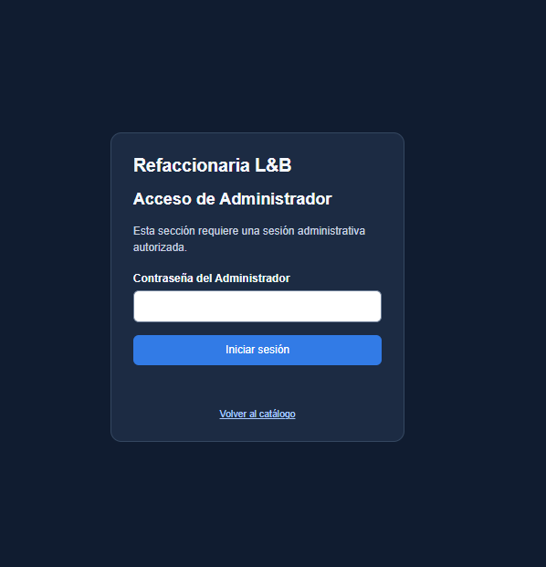

*Figura 10. Pantalla de autenticación administrativa.*

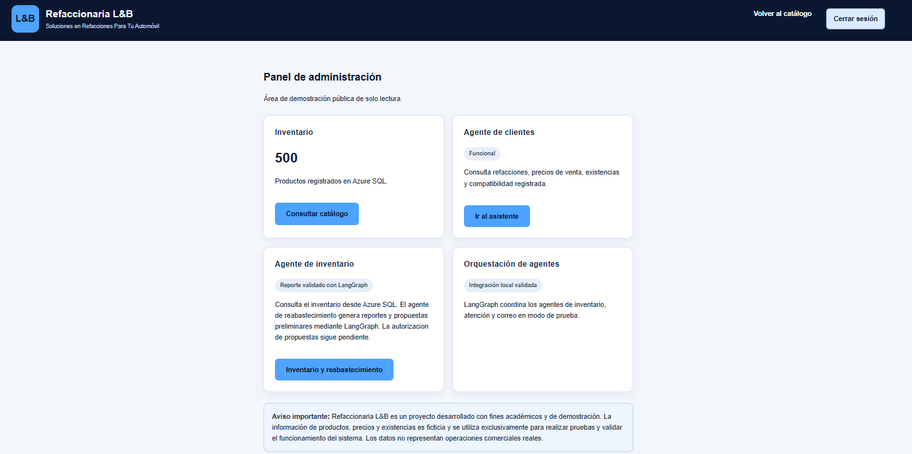

*Figura 11. Vista del panel administrativo.*

## 7. Etapa 4. Orquestación de agentes mediante LangGraph

**Objetivo.** Coordinar funciones de consulta de inventario, atención al cliente y evaluación de solicitudes relacionadas con correo, sin realizar acciones comerciales automáticas.

**Actividades.** Se implementó un flujo de orquestación que identifica la intención de la consulta, recupera información del inventario y genera una respuesta. El componente de correo determina si corresponde preparar un borrador; no envía mensajes automáticamente.

**Prueba realizada.** Ante la pregunta «¿Tienen balatas para Honda City 2022?», el flujo recuperó **7 productos**. La consulta no requería un borrador de correo.

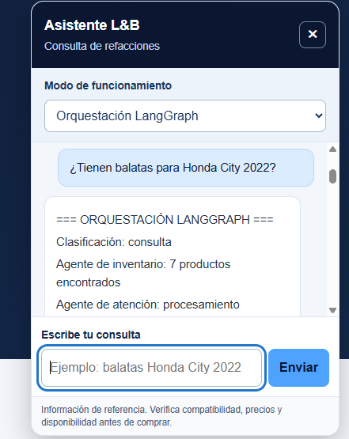

*Figura 12. Evidencia de la consulta y respuesta coordinada mediante LangGraph.*

| Código | Marca | Precio de prueba (MXN) | Existencia de prueba |
|---|---|---:|---:|
| LB-0002 | Motorcraft | $5,596.64 | 9 |
| LB-0082 | ACDelco | $2,486.36 | 25 |
| LB-0162 | Denso | $4,706.64 | 25 |
| LB-0242 | Motorcraft | $1,358.59 | 37 |
| LB-0322 | ACDelco | $2,376.94 | 38 |
| LB-0402 | Denso | $4,167.95 | 29 |
| LB-0482 | Motorcraft | $457.29 | 25 |

*Datos de prueba obtenidos en la consulta validada. La compatibilidad indicada por el sistema no sustituye la verificación técnica del fabricante.*

## 8. Etapa 5. Integración con Microsoft Foundry

**Objetivo.** Incorporar un segundo modo de asistencia inteligente que pueda consultar el inventario de Refaccionaria L&B.

**Actividades.** Se configuró en Microsoft Foundry el agente `Agente-Refaccionaria-LB`, versión 5, con un modelo de la familia GPT y una herramienta OpenAPI denominada `ConsultarInventarioLB`. Se realizaron pruebas controladas de consulta al inventario.

**Prueba directa en Foundry.** Se preguntó por balatas delanteras para Honda City 2022, solicitando código, marca, precio y existencias. El agente recuperó **7 productos**. La interfaz registró una ejecución de aproximadamente **77 segundos** y **4,381 tokens** para esa prueba.

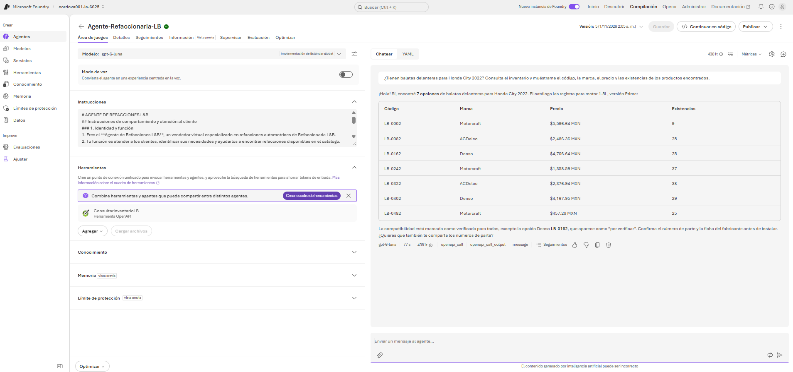

*Figura 13. Evidencia de la consulta realizada directamente en Microsoft Foundry.*

**Prueba desde la aplicación web.** También se seleccionó el modo «Asistente Foundry» en Refaccionaria L&B y se obtuvo una respuesta con los siete productos consultados, incluyendo datos de identificación, precios y existencias.

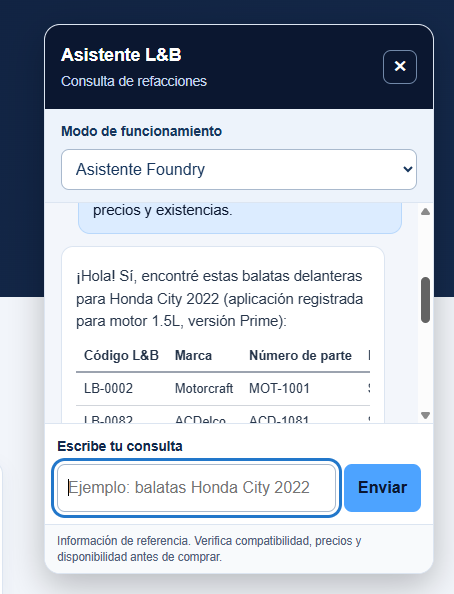

*Figura 14. Evidencia de respuesta del asistente Foundry desde la interfaz web.*

**Resultado.** Se validaron tanto la consulta directa al agente de Foundry como su uso desde el asistente de la página. No fue necesario repetir estas pruebas para elaborar el informe.

## 9. Etapa 6. Inventario y propuestas de reabastecimiento

**Objetivo.** Apoyar la identificación de productos con existencias insuficientes y presentar información útil para decisiones administrativas.

**Actividades.** Se implementaron indicadores y propuestas preliminares para revisión desde el panel administrativo.

| Indicador | Resultado de prueba |
|---|---:|
| Productos registrados | 500 |
| Productos que requieren reabastecimiento | 94 |
| Productos agotados | 6 |
| Propuestas preliminares | 72 |
| Piezas faltantes consideradas en propuestas | 335 |

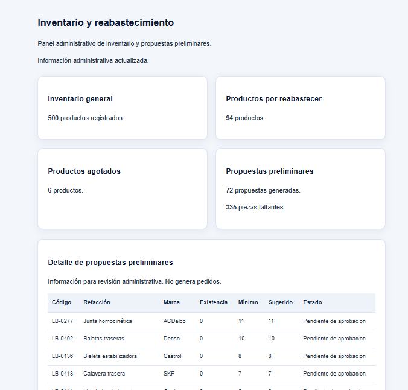

*Figura 15. Indicadores del inventario y propuestas pendientes de revisión.*

**Resultado y límite.** Las propuestas son informativas, requieren revisión y autorización, y **no generan órdenes de compra ni modifican automáticamente las existencias**.

## 10. Arquitectura y herramientas utilizadas

| Herramienta | Función dentro del proyecto |
|---|---|
| Microsoft Excel | Digitalización inicial y organización del catálogo |
| Azure SQL | Base de datos centralizada del inventario |
| Node.js y JavaScript | Servidor, API y lógica de la aplicación |
| HTML y CSS | Interfaz y presentación web |
| Azure App Service | Alojamiento de la aplicación |
| GitHub Actions | Automatización de compilación y despliegue |
| LangGraph | Orquestación de los flujos de agentes |
| Microsoft Foundry | Configuración y ejecución del asistente inteligente |
| OpenAPI | Herramienta de consulta de inventario para el agente Foundry |

**Flujo general:** Excel → Azure SQL → API Node.js → Aplicación web (Cliente/Administrador) → consultas y asistentes LangGraph/Foundry. Las propuestas de reabastecimiento se presentan al Administrador para revisión.

## 11. Seguridad, controles y costos

- Se contemplan únicamente los accesos **Cliente** y **Administrador**.
- El panel administrativo requiere autenticación; la contraseña no se publica en este documento.
- Se implementaron medidas de protección de credenciales y separación entre consulta pública y funciones administrativas.
- Las instrucciones y los datos recuperados por los agentes deben tratarse de manera diferenciada; los mensajes de usuarios y correos no deben poder atribuirse privilegios por incluir etiquetas o instrucciones aparentes.
- No se autorizan compras, correos automáticos ni modificaciones de inventario por respuestas del asistente.
- Se configuró un presupuesto de seguimiento de Azure de **10 USD**, con alertas al 50 %, 80 % y 100 %. **Las alertas no detienen automáticamente el consumo.**
- Las pruebas de Foundry se realizaron de manera controlada; los límites de solicitudes o tokens por minuto no equivalen a un límite de gasto.

## 12. Pruebas y resultados funcionales

| Funcionalidad | Evidencia o resultado |
|---|---|
| Catálogo inicial en Excel | 500 productos organizados |
| Base de datos Azure SQL | 500 registros en `dbo.Productos` |
| Catálogo web | Consulta y búsqueda de refacciones |
| LangGraph | Consulta de balatas para Honda City 2022: 7 resultados |
| Microsoft Foundry, prueba directa | Consulta al inventario: 7 resultados |
| Asistente Foundry desde la web | Respuesta con productos, precios y existencias |
| Acceso administrativo | Pantalla protegida de autenticación |
| Inventario y reabastecimiento | 94 por reabastecer, 6 agotados, 72 propuestas preliminares |

Las capturas correspondientes se muestran junto a cada etapa y no implican validación de funciones ajenas a las pruebas descritas.

## 13. Limitaciones y mejoras futuras

La plataforma es una demostración académica y utiliza información ficticia. No procesa pagos ni ventas reales; las propuestas no realizan compras; y la compatibilidad vehicular debe verificarse con fuentes técnicas antes de una operación comercial. Entre las mejoras futuras se encuentran ampliar las pruebas de seguridad, fortalecer la validación de compatibilidad, profundizar la gestión administrativa y preparar la portabilidad del sistema fuera de la suscripción estudiantil.

## 14. Acceso para la evaluación

**Sitio web:** https://refaccionarialb-hpbaffdrbyh2hxhx.northcentralus-01.azurewebsites.net/

El profesor puede abrir el enlace, explorar la página principal y el catálogo, utilizar las funciones disponibles y revisar las evidencias de este informe.

**Acceso administrativo:** la contraseña no se comparte públicamente. Para solicitar acceso administrativo de demostración, contactar a los responsables del proyecto.

**Nota sobre la publicación:** los cambios locales recientes que incorporan los nombres de los autores y actualizan el texto de «Transformación digital» se publicarán en Azure únicamente después de la revisión final y la autorización de despliegue.

## 15. Conclusiones

Refaccionaria L&B demuestra una evolución desde la administración manual hacia una plataforma digital que centraliza 500 productos de prueba en Azure SQL, permite consultas web, presenta información administrativa y utiliza agentes inteligentes para apoyar la atención y la búsqueda de refacciones. Las pruebas documentadas de LangGraph y Microsoft Foundry muestran la recuperación de productos del inventario. El proyecto proporciona una base funcional para futuras mejoras, manteniendo claros sus límites académicos y de seguridad.

---

### Elaborado por

**Mónica Torres Córdova**
**Orlando Torres Córdoba**

**Refaccionaria L&B — 6 de noviembre de 2026**
